<p align="center">
  <a href="https://mynodebtc.com"></a>
</p>

<p align="center">
  <b>The easiest way to run your own Bitcoin and Lightning node.</b>
</p>

<p align="center">
  <a href="https://github.com/mynodebtc/mynode/tags"></a>
  <a href="https://t.me/mynode_btc"></a>
  <a href="https://x.com/mynodebtc"></a>
</p>

<p align="center">
  <a href="https://mynodebtc.com">Website</a> ·
  <a href="https://mynodebtc.com/download">Download</a> ·
  <a href="https://docs.mynodebtc.com">Docs</a> ·
  <a href="https://mynodebtc.com/order_now">Buy a Device</a> ·
  <a href="https://t.me/mynode_btc">Telegram</a> ·
  <a href="https://mynodebtc.com/support">Support</a>
</p>

<p align="center">
  <picture>
    <source media="(prefers-color-scheme: dark)" srcset="images/ui_home_dark.png">
    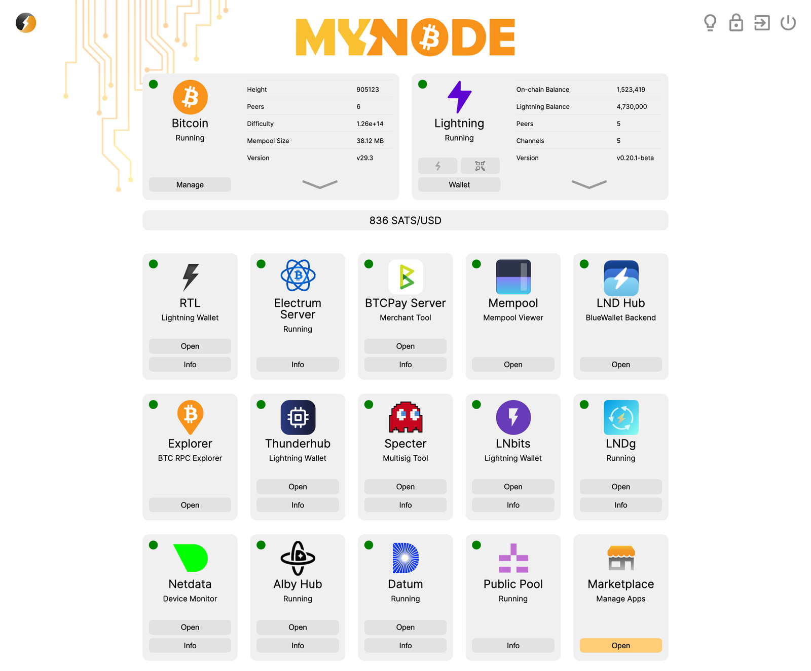
  </picture>
</p>

## Why MyNode

MyNode combines the best open source Bitcoin software with a simple web interface, one-click
apps, upgrades and support, so you can use Bitcoin and Lightning privately and securely.

- **Verify, don't trust.** Your own full node checks every block and transaction, so you no
  longer rely on third-party explorers or wallet servers that can track you or lie to you.
- **Bitcoin and Lightning in one box.** Run a Lightning node, connect your wallets, and accept
  payments from hardware you control.
- **Dozens of apps.** Install wallets, explorers, payment servers and Lightning tools from the
  marketplace with one click.
- **Dedicated hardware.** Runs around the clock on a Raspberry Pi, a mini PC, a virtual machine,
  or a MyNode Model Two.

## What's Included

<table>
  <tr><th colspan="7" align="left">Bitcoin</th></tr>
  <tr>
    <td align="center" valign="top" width="14%"><br><sub>Bitcoin Core</sub></td>
    <td align="center" valign="top" width="14%"><br><sub>Electrum Server</sub></td>
    <td align="center" valign="top" width="14%"><br><sub>Mempool</sub></td>
    <td align="center" valign="top" width="14%"><br><sub>BTC RPC Explorer</sub></td>
    <td align="center" valign="top" width="14%">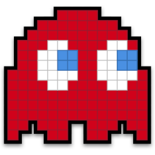<br><sub>Specter</sub></td>
    <td align="center" valign="top" width="14%"><br><sub>Caravan</sub></td>
    <td align="center" valign="top" width="14%"><br><sub>Lily Wallet</sub></td>
  </tr>
  <tr>
    <td align="center" valign="top" width="14%"><br><sub>JoinMarket</sub></td>
    <td align="center" valign="top" width="14%"><picture><source media="(prefers-color-scheme: dark)" srcset="images/app_icons_dark/jam.png"></picture><br><sub>Jam</sub></td>
    <td align="center" valign="top" width="14%">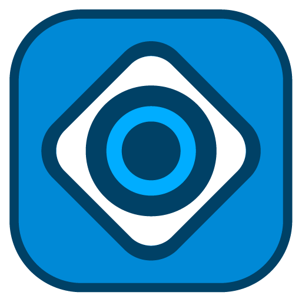<br><sub>CKBunker</sub></td>
    <td align="center" valign="top" width="14%">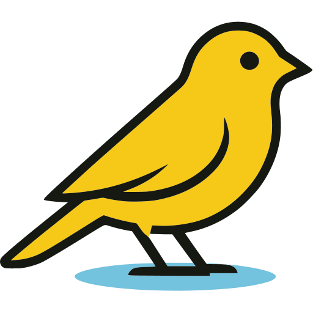<br><sub>Canary</sub></td>
    <td align="center" valign="top" width="14%"><br><sub>Warden Terminal</sub></td>
    <td align="center" valign="top" width="14%">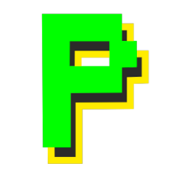<br><sub>PyBlock</sub></td>
  </tr>
  <tr><th colspan="7" align="left">Lightning</th></tr>
  <tr>
    <td align="center" valign="top" width="14%"><br><sub>LND</sub></td>
    <td align="center" valign="top" width="14%"><picture><source media="(prefers-color-scheme: dark)" srcset="images/app_icons_dark/rtl.png">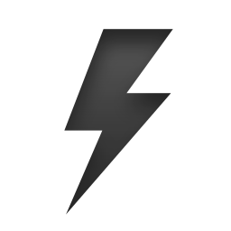</picture><br><sub>Ride the Lightning</sub></td>
    <td align="center" valign="top" width="14%">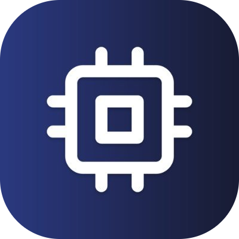<br><sub>Thunderhub</sub></td>
    <td align="center" valign="top" width="14%">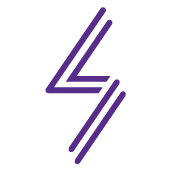<br><sub>Lightning Terminal</sub></td>
    <td align="center" valign="top" width="14%">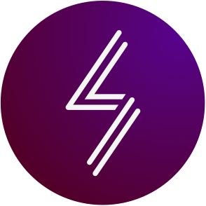<br><sub>Loop</sub></td>
    <td align="center" valign="top" width="14%">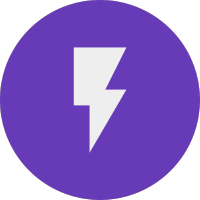<br><sub>LNbits</sub></td>
    <td align="center" valign="top" width="14%"><br><sub>LNDg</sub></td>
  </tr>
  <tr>
    <td align="center" valign="top" width="14%"><br><sub>Alby Hub</sub></td>
    <td align="center" valign="top" width="14%"><br><sub>Balance of Satoshis</sub></td>
    <td align="center" valign="top" width="14%"><br><sub>Pool</sub></td>
    <td align="center" valign="top" width="14%">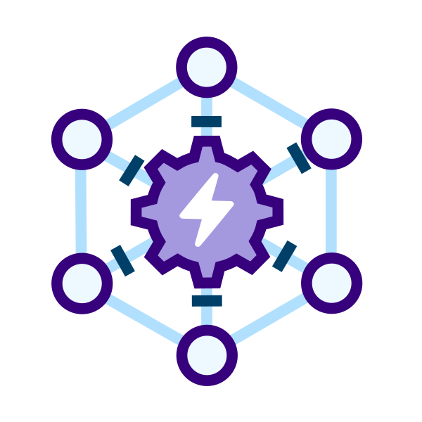<br><sub>LNDManage</sub></td>
    <td align="center" valign="top" width="14%">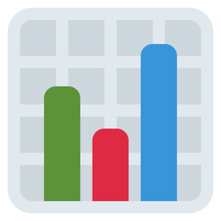<br><sub>lntop</sub></td>
    <td align="center" valign="top" width="14%">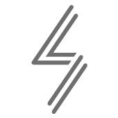<br><sub>Channel Tools</sub></td>
    <td align="center" valign="top" width="14%"><br><sub>LNDConnect</sub></td>
  </tr>
  <tr><th colspan="7" align="left">Payments</th></tr>
  <tr>
    <td align="center" valign="top" width="14%">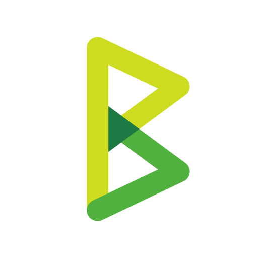<br><sub>BTCPay Server</sub></td>
    <td align="center" valign="top" width="14%"><br><sub>LND Hub</sub></td>
  </tr>
  <tr><th colspan="7" align="left">Mining</th></tr>
  <tr>
    <td align="center" valign="top" width="14%">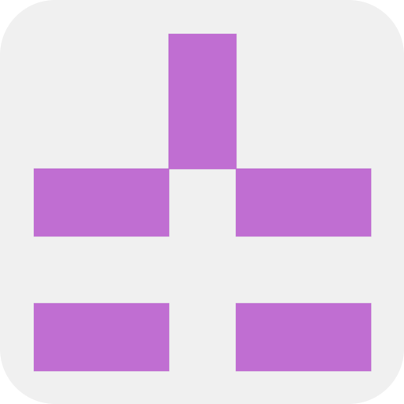<br><sub>Public Pool</sub></td>
    <td align="center" valign="top" width="14%"><br><sub>DATUM</sub></td>
  </tr>
  <tr><th colspan="7" align="left">Nostr and chat</th></tr>
  <tr>
    <td align="center" valign="top" width="14%">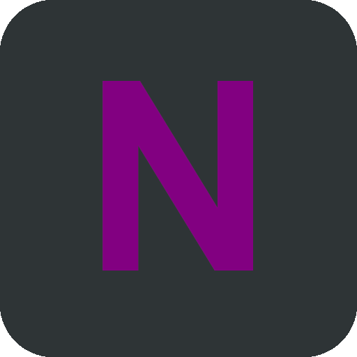<br><sub>Nostr RS Relay</sub></td>
    <td align="center" valign="top" width="14%">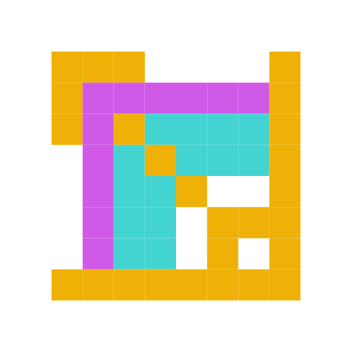<br><sub>Astral</sub></td>
    <td align="center" valign="top" width="14%"><br><sub>Noscl</sub></td>
    <td align="center" valign="top" width="14%"><br><sub>Sphinx Relay</sub></td>
  </tr>
  <tr><th colspan="7" align="left">System</th></tr>
  <tr>
    <td align="center" valign="top" width="14%"><br><sub>Tor</sub></td>
    <td align="center" valign="top" width="14%"><br><sub>VPN</sub></td>
    <td align="center" valign="top" width="14%"><br><sub>Tailscale</sub></td>
    <td align="center" valign="top" width="14%">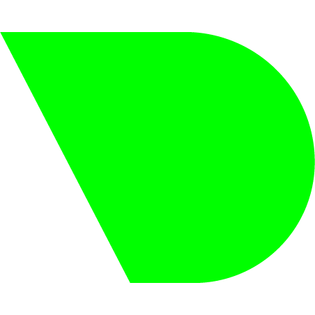<br><sub>Netdata</sub></td>
    <td align="center" valign="top" width="14%">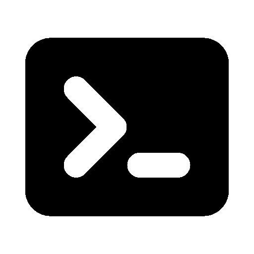<br><sub>Terminal</sub></td>
  </tr>
</table>

MyNode also sets up a firewall and Docker.

New apps are added through the [app SDK](doc/applications.md).

## Get Started

### Supported hardware

| Hardware | Image | Data drive |
|---|---|---|
| [MyNode Model Two](https://mynodebtc.com/products/two) | Comes pre-installed | Internal 2 TB NVMe SSD |
| Raspberry Pi 5 | Raspberry Pi 4/5 | 2 TB SSD over USB 3 |
| Raspberry Pi 4 | Raspberry Pi 4/5 | 2 TB SSD over USB 3 |
| PC or mini PC (amd64) | PC | Internal 2 TB SSD |
| Virtual machine (VirtualBox, VMware) | OVA | Virtual disk, 2 TB |

### Install

1. [Download the image](https://mynodebtc.com/download) for your hardware.
2. Flash it to an SD card (Raspberry Pi) or USB flash drive (PC) with
   [Balena Etcher](https://etcher.balena.io/) or
   [Raspberry Pi Imager](https://www.raspberrypi.com/software/).
3. Insert the card or drive, attach the data drive, and connect an Ethernet cable.
4. Power on, then open <http://mynode.local/> or `http://<device-ip>/`.
5. [Upgrade](https://docs.mynodebtc.com/device/upgrading-device.html) to the latest version
   before you start using it.

<details>
<summary><b>Install on an existing Debian system (beta)</b></summary>

<br>

On a supported device already running Debian 12 (Bookworm), log in and run:

```bash
wget https://raw.githubusercontent.com/mynodebtc/mynode/latest_release/setup/setup_device.sh -O mynode_setup.sh
sudo bash ./mynode_setup.sh online
```

Reboot when the script finishes and the device will be running MyNode.

</details>

## MyNode Model Two and Premium

The Model Two is a supported, ready-to-run MyNode device. Premium adds one-click upgrades and
priority support to MyNode Community Edition.
[Order a device or upgrade](https://mynodebtc.com/order_now).

<p align="center">
  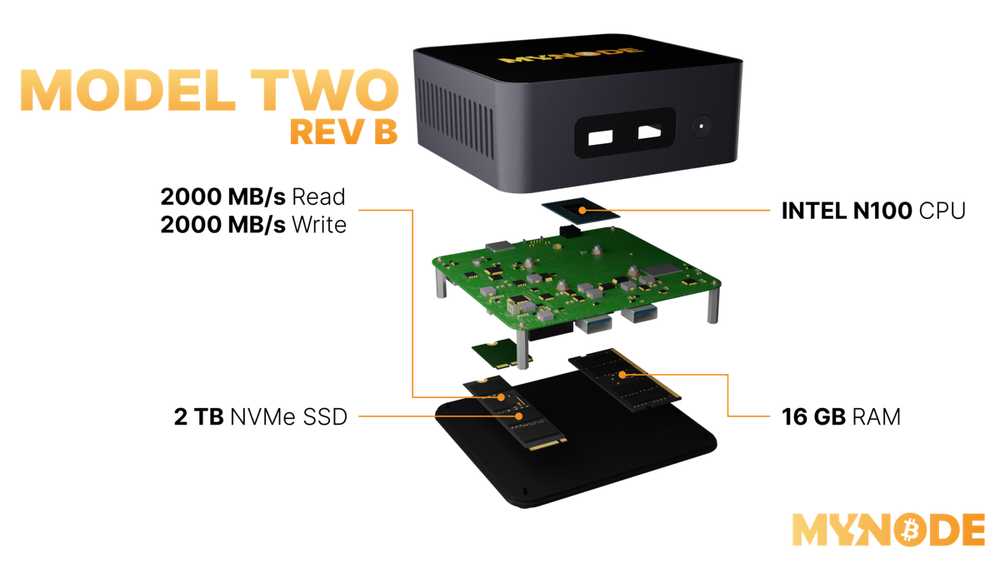
</p>

## Screenshots

<table>
  <tr>
    <td width="50%" valign="top">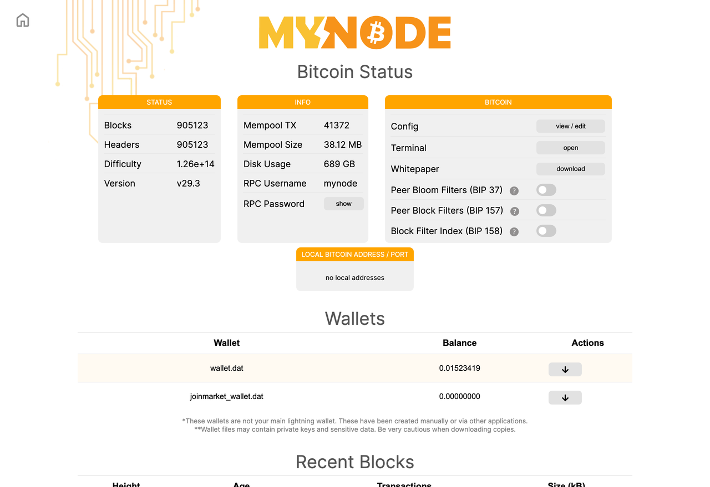</td>
    <td width="50%" valign="top">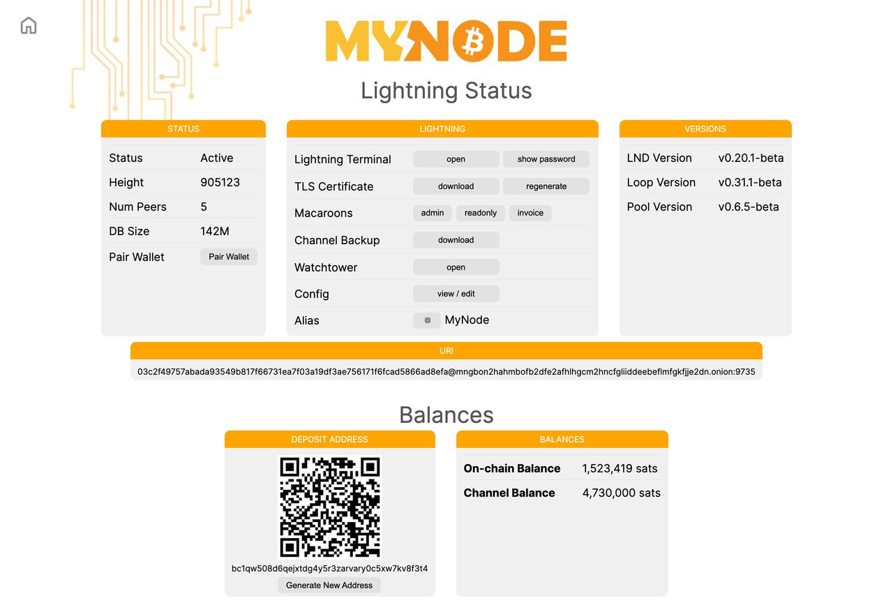</td>
  </tr>
  <tr>
    <td width="50%" valign="top">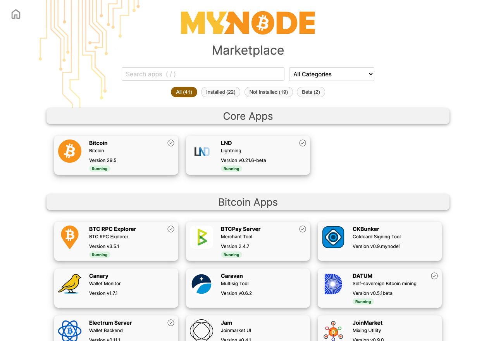</td>
    <td width="50%" valign="top">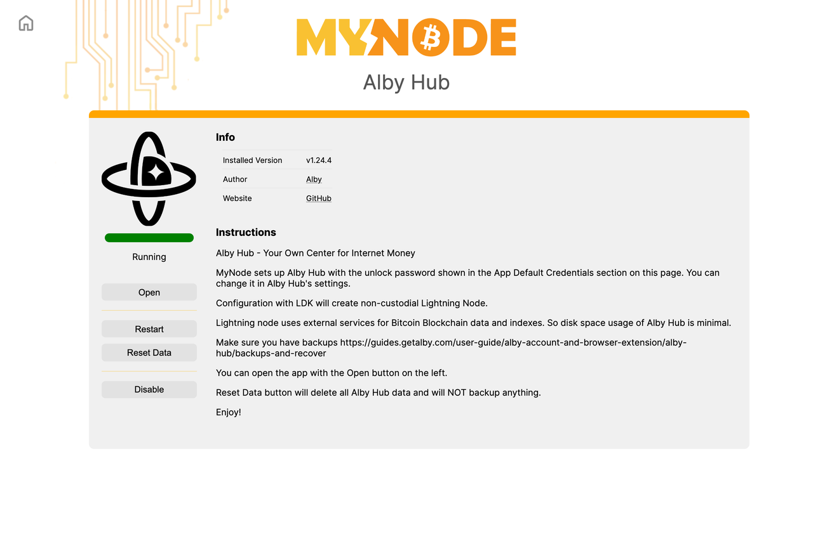</td>
  </tr>
</table>

## Contributing

- **Platform:** start with the [development guide](doc/development.md).
- **Web UI:** `make dev-ui` runs the real web interface in Docker with a mocked backend, no
  device needed. See the [UI dev mode guide](dev/dev-ui/README.md).
- **Apps:** add a new application with the [application guide](doc/applications.md).

The MyNode community helps with development and support every day. This project would not be
possible without them.

## Security

Found a vulnerability? Please report it privately. See the [security policy](.github/SECURITY.md).

> [!WARNING]
> MyNode is not responsible for lost funds. Lightning wallets stay online to spend, which
> carries more risk than cold storage. Keep long-term savings on a hardware wallet, and learn
> how Bitcoin and Lightning work before you put funds on your node.

## License

The MyNode platform uses a variation of CC BY-NC-ND 4.0 with changes in Section 9. See
[LICENSE.md](LICENSE.md).

Each bundled application has its own license. The code that integrates applications into
MyNode, under `rootfs/standard/usr/share/mynode_apps/`, uses the LGPL v3.0 in
[that folder's LICENSE.md](rootfs/standard/usr/share/mynode_apps/LICENSE.md).

<details>
<summary><b>New to Bitcoin?</b></summary>

<br>

Bitcoin is digital money you can send over the Internet without banks or other third parties.
Anyone with an Internet connection can use it, wherever they live. Only 21 million bitcoin will
ever exist, and no person, company or government can change that limit.

The Lightning Network is a layer on top of Bitcoin for fast payments. Instead of waiting for
each transaction to be confirmed in a block, Lightning lets people send bitcoin back and forth
instantly.

To learn more, start with [Jameson Lopp's Bitcoin resources](https://www.lopp.net/bitcoin-information.html).

</details>
